1) `AVG` - среднее значение

1.1. Найти среднее значение стоимости всех проданных абонементов

SELECT AVG(Price) AS average_price 
FROM membership;

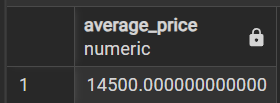

1.2. Найти средний возраста тренеров

SELECT AVG(age) AS average_age
FROM coach; 

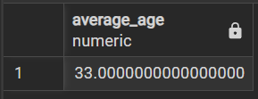

2) `COUNT` - количество строк в выборке

2.1. Вывести количество строк в таблице 

SELECT COUNT(*) 
FROM training;

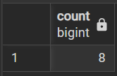

2.2. Вывести количество разных клиентов, которые записывались на тренировку

SELECT COUNT(DISTINCT client_id) 
FROM visit;

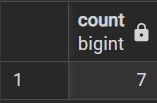

3) MIN и MAX

3.1. Найти минимальный возраст тренера

SELECT MIN(age) AS min_age 
FROM coach;

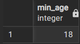

3.2. Найти максимальную цену абонемента

SELECT MAX(price) AS max_price 
FROM membership;

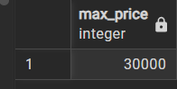

4) `SUM` - сумма значение столбца

4.1. Вывести вместимость всех залов

SELECT SUM(capacity) 
FROM room;

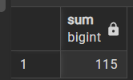

4.2. Вывести сумму стоимости всех абонементов

SELECT SUM(price) 
FROM membership;

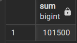

5) `STRING_AGG` - объединение строковых значений

5.1. Вывести в одну строчку через '//' имена клиентов

SELECT STRING_AGG(full_name, ' // ') 
FROM client;

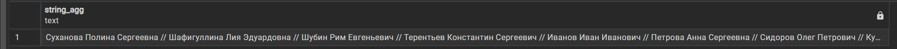

5.2. Вывести в одну строчку через ',' названия тренировочных залов

SELECT STRING_AGG(room_name, ', ') 
FROM room;

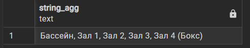

6) `GROUP_BY` - группировка строк

6.1. Вывести id клиентов и количество их записей на тренировкм (по возрастанию id клиента)

SELECT client_id, COUNT(*) AS all_visits
FROM visit
GROUP BY client_id
ORDER BY client_id;

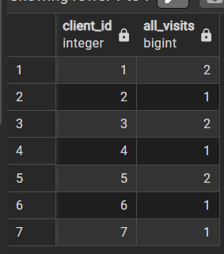

6.2. Вывести, сколько каждый кдиент потратил на абонементы (по убыванию суммы)

SELECT client_id, SUM(price) AS total_price
FROM membership
GROUP BY client_id
ORDER BY total_price DESC;

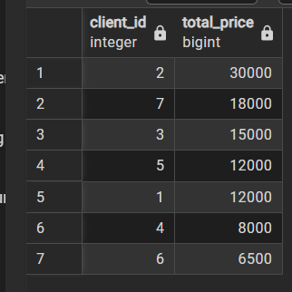

7) `HAVING` - фильтрация групп

7.1. Вывести количество посещенных тренировок по каждому клиентц

SELECT client_id, COUNT(*) AS all_visits
FROM visit
GROUP BY client_id, attended
HAVING attended = 'true';

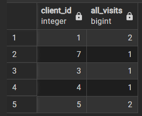

7.2. Вывести клиентов, которые потратили на абонементы больше 10_000

SELECT client_id, SUM(price) AS total_price
FROM membership
GROUP BY client_id
HAVING SUM(price) > 10000
ORDER BY total_price DESC;

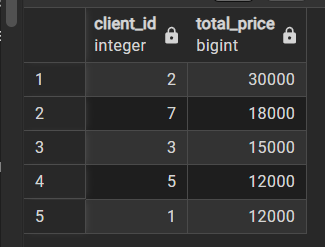

8) `GROUPING SETS` -  несколько разных группировок в одной таблице

8.1. Посчитать записи на тренировки: по паре «клиент — тренировка», отдельно по клиентам, отдельно по тренировкам и общий итог

SELECT client_id, training_id, COUNT(*) AS all_visits   
FROM visit
GROUP BY
    GROUPING SETS ((client_id, training_id), (client_id), (training_id), ());

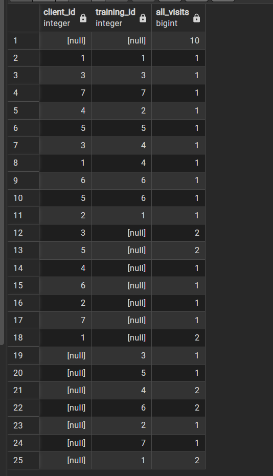

8.2. Посчитать залы: по паре «название — вместимость», по названию и общий итог

SELECT room_name, capacity, COUNT(*)
FROM room
GROUP BY
    GROUPING SETS ((room_name, capacity), (room_name), ());

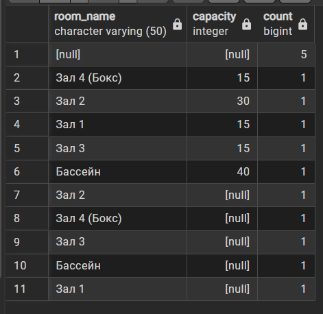

9) `ROLLUP` - промежуточные итоги слева направо

9.1. Вывести возраст каждого тренера, средний возраст по каждой специализации и общий средний возраст

SELECT specialization, full_name, ROUND(AVG(age), 1) AS average_age
FROM coach
GROUP BY ROLLUP(specialization, full_name)
ORDER BY specialization, full_name;

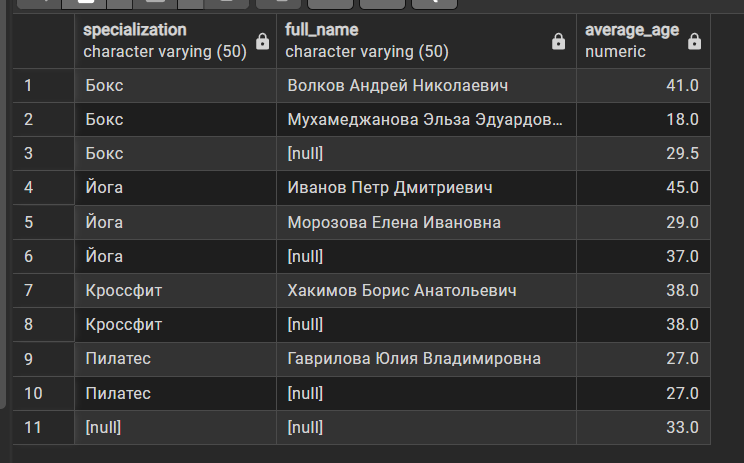

9.2. Посчитать записи на каждую тренировку с разбивкой на «пришёл / не пришёл», итог по каждой тренировке и общий итог

SELECT training_id, attended, COUNT(*) AS visits
FROM visit
GROUP BY ROLLUP(training_id, attended)
ORDER BY training_id, attended;

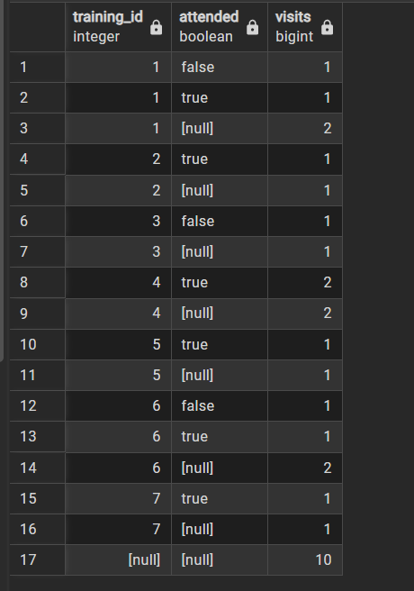

10) `CUBE` - итоги по всем возможным комбинациям столбцов

10.1. Посчитать записи по клиентам и факту посещения во всех комбинациях: клиент + посещение, только клиент, только посещение, общий итог

SELECT client_id, attended, COUNT(*) AS visits
FROM visit
GROUP BY CUBE(client_id, attended)
ORDER BY client_id, attended;

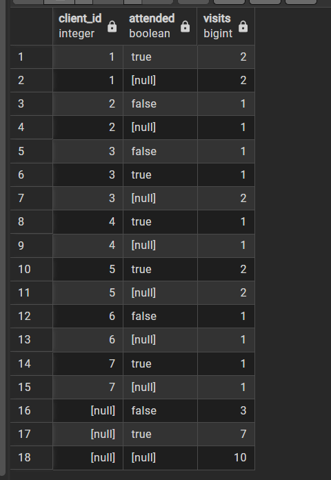

10.2. Посчитать тренеров по специализации и возрасту во всех комбинациях

SELECT specialization, age, COUNT(*) AS coaches_count
FROM coach
GROUP BY CUBE(specialization, age)
ORDER BY specialization, age;

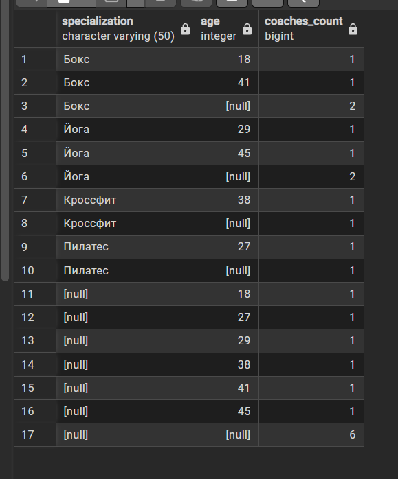

11) `SELECT`, `FROM`, `WHERE`, `GROUP BY`, `HAVING`, `ORDER BY` - полный запрос

11.1. Вывести клиентов, которые реально пришли хотя бы на 2 тренировки (по убыванию количества посещений)

SELECT client_id, COUNT(*) AS attended_visits
FROM visit
WHERE attended = 'true'
GROUP BY client_id
HAVING COUNT(*) >= 2
ORDER BY attended_visits DESC, client_id;

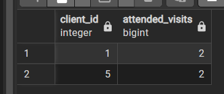

11.2. Среди тренеров от 25 лет вывести специализации, где средний возраст больше 30 (по убыванию среднего возраста)

SELECT specialization, COUNT(*), ROUND(AVG(age), 1) AS average_age
FROM coach
WHERE age >= 25
GROUP BY specialization
HAVING AVG(AGE) > 30
ORDER BY average_age DESC;

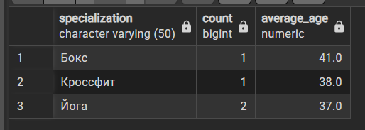