1. SELECT

1.1. -- Вывести имена всех тренеров и средний возраст всех тренеров в клубе

SELECT full_name, ROUND((SELECT AVG(age) from coach), 2) AS avg_coaches_year 
FROM coach;

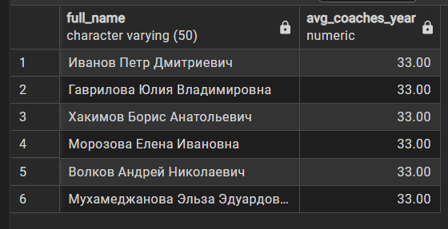

1.2. --  Вывести название каждой тренировки и её длительность, а также разницу между длительностью этой тренировки и максимальной длительностью среди всех тренировок

SELECT training_name, duration, (SELECT MAX(duration) FROM training) - duration AS difference_between
FROM training;

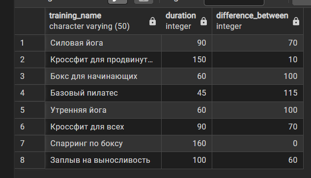

2. FROM 

2.1. -- Найти клиентов, которые посетили 2 и более тренировок

SELECT client_id 
FROM (SELECT client_id, COUNT(*) AS visits_count
        FROM visit
        WHERE attended = TRUE 
        GROUP BY client_id)
    AS statistic 
    WHERE visits_count >= 2;

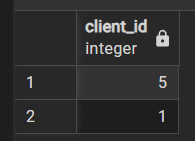

2.2. -- Вывести среднюю стоимость абонемента по каждой дате начала, только для тех дат, где стоимость абонемента > 10000

SELECT start_date, ROUND(AVG(price), 2) AS avg_price
FROM (SELECT start_date, price
        FROM membership
        WHERE price > 10000)
    AS limited_price_memberships
GROUP BY start_date;

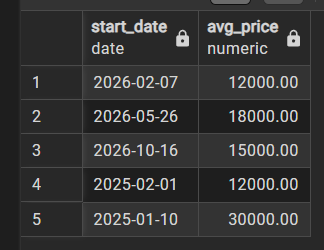

3. WHERE

3.1 -- Вывести имя и телефон клиентов, которые имеют абонемент 

SELECT full_name, phone
FROM client
WHERE client_id IN (SELECT client_id 
    FROM membership);

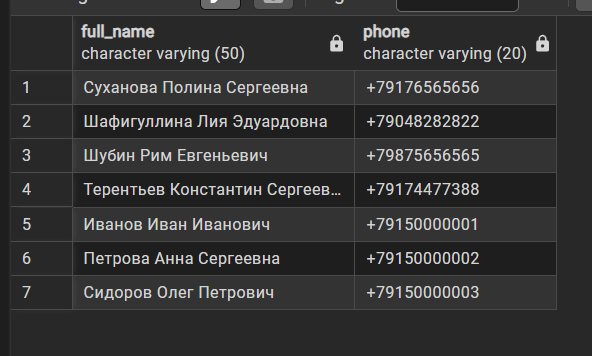

3.2. --  Вывести названия всех тренировок, которые проходят в том же зале, где проходит тренировка с названием 'Силовая йога'

SELECT training_name
FROM training 
WHERE room_id IN (SELECT room_id
    FROM training
    WHERE training_name = 'Силовая йога');

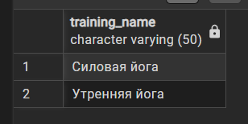

4. HAVING 

4.1. --  Вывести специализации тренеров и их средний возраст, для тех специализаций, где средний возраст больше, чем средний возраст по всему клубу

SELECT specialization, ROUND(AVG(age), 2) AS avg_age 
FROM coach
GROUP BY specialization
HAVING AVG(age) > (SELECT AVG(age) FROM coach);

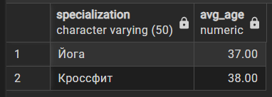

4.2. --  Вывести id клиента и сумму, которую клиент потратил на абонементы, для тех клиентов, чья сумма >= максимальной цены одного абонемента

SELECT client_id, SUM(price) as total_price
FROM membership
GROUP BY client_id
HAVING SUM(price) >= (SELECT MAX(price) FROM membership);

5. ALL 

5.1. -- Найти тренировки, длительность которых больше длительности любой тренировки с тренером coach_id = 1

SELECT training_name, duration
FROM training
WHERE duration > ALL(SELECT duration FROM training
        WHERE coach_id = 1);

значит, максимальная по длительности тренировка у тренера с coach_id = 1

5.2. -- Найти клиентов, которые записывались на тренировки, при этом client_id больше, чем все client_id клиентов, у которых нет абонемента.

SELECT DISTINCT client_id
FROM visit
WHERE client_id > ALL(SELECT c.client_id FROM client c
        LEFT JOIN membership m ON c.client_id = m.client_id
        WHERE m.membership_id IS NULL);

6. IN / NOT IN

6.1. -- Вывести имена клиентов, которые никогда не записывались ни на одну тренировку 

SELECT full_name 
FROM client
WHERE client_id NOT IN (SELECT DISTINCT client_id FROM visit);

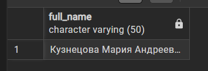

6.2. -- Вывести имена и специализацию тренеров, которые ведут тренировки в «Бассейне»

SELECT full_name, specialization 
FROM coach
WHERE coach_id IN (SELECT t.coach_id FROM training t
        JOIN room r ON t.room_id = r.room_id
        WHERE r.room_name = 'Бассейн');

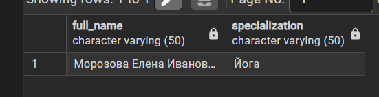

    
7. ANY / SOME

7.1. --  Найти клиентов, которые потратили на абонемент больше, чем хотя бы один (любой)клиент из списка client_id = (1, 2, 3) на один абонемент

SELECT client_id, SUM(price) AS total_price
FROM membership
GROUP BY client_id
HAVING SUM(price) > ANY(SELECT price FROM membership
        WHERE client_id IN (1, 2, 3));

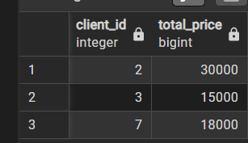

7.2. -- Найти тренировки, которые длятся дольше, чем любая (хотя бы одна) тренировка в зале room_id = 2

SELECT training_id, duration
FROM training 
WHERE duration > ANY(SELECT duration FROM training
        WHERE room_id = 2);

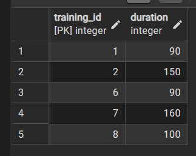

    
8. EXISTS / NOT EXISTS 

8.1. --  Вывести имена клиентов, у которых есть абонемент

SELECT c.full_name
FROM client c
WHERE EXISTS (SELECT 1 FROM membership m
    WHERE m.client_id = c.client_id);

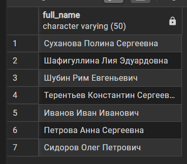

8.2. -- Вывести названия залов, в которых нет ни одной тренировки

SELECT r.room_name 
FROM room r
WHERE NOT EXISTS (SELECT 1 FROM training t
    WHERE t.room_id = r.room_id);

9. Сравнение по нескольким столбцам 

9.1. -- Вывести все тренировки, которые проводятся в то же время и в том же зале, что и тренировка «Утренняя йога»

SELECT * FROM training
WHERE (datetime, room_id) IN (SELECT datetime, room_id
    FROM training
    WHERE training_name = 'Утренняя йога');

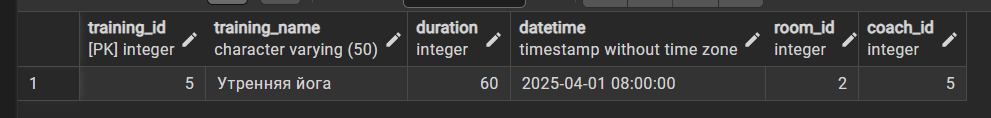

9.2. --  Найти клиентов и их абонементы, у которых цена и дата окончания совпадают с ценой и датой окончания самого дорогого абонемента

SELECT * FROM membership 
WHERE (price, end_date) IN (SELECT price, end_date 
    FROM membership 
    ORDER BY price DESC
    LIMIT 1);

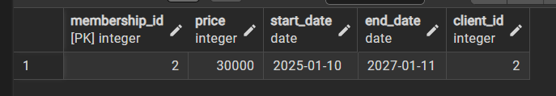

10. Коррелированные запросы

10.1. -- Вывести имя и телефон клиентов, которые посетили хотя бы одну тренировку тренера с coach_id = 3

SELECT full_name, phone
FROM client c
WHERE EXISTS 
    (SELECT 1 FROM visit v
    JOIN training t ON t.training_id = v.training_id
    WHERE t.coach_id = 3 AND v.client_id = c.client_id);

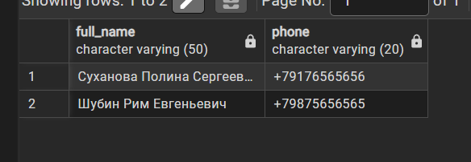

10.2. --  Вывести названия залов, в которых нет ни одной тренировки длительностью более 90 минут

SELECT room_name
FROM room r
WHERE NOT EXISTS (
    SELECT 1 FROM training t
    WHERE r.room_id = t.room_id AND duration > 90
);

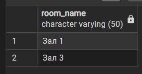

10.3. --  Вывести имя и специализацию тренеров, на тренировки которых не записался ни один клиент 

SELECT full_name, specialization 
FROM coach c
WHERE NOT EXISTS (
    SELECT 1 FROM training t
    JOIN visit v ON t.training_id = v.training_id
    WHERE c.coach_id = t.coach_id
);

10.4. --  Вывести имена клиентов, у которых стоимость абонемента строго больше, чем стоимость абонемента клиента «Шубин Рим Евгеньевич» 

SELECT full_name
FROM client c
WHERE (SELECT price FROM membership m
    WHERE m.client_id = c.client_id) > 
    (SELECT price FROM membership m1
    JOIN client c2 ON c2.client_id = m1.client_id
    WHERE c2.full_name = 'Шубин Рим Евгеньевич'
);

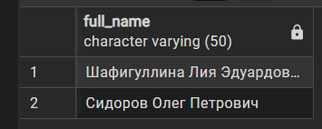

10.5. -- Вывести имя и специализацию тренеров, у которых общая длительность всех их тренировок строго больше, чем средняя общая длительность тренировок по всем тренерам

SELECT c.full_name, c.specialization
FROM coach c
WHERE (
    SELECT SUM(t.duration) 
    FROM training t
    WHERE t.coach_id = c.coach_id
    ) > (
        SELECT AVG(coach_total) 
    FROM (
        SELECT SUM(duration) AS coach_total 
        FROM training 
        GROUP BY coach_id
    ) AS duration_sums
);

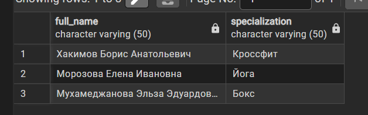