1. CTE (обобщенное таблицное выражение)

    1.1. Вывести имена клиентов и сумму, которые они потратили на абонементы.Оставить только тех, кто потратил более 10 000 рублей, отсортировать по убыванию трат.

    WITH client_spending AS
        (SELECT client_id, SUM(price) AS total_price
        FROM membership
        GROUP BY client_id) 

    SELECT client.full_name, client_spending.total_price
    FROM client
    INNER JOIN client_spending ON client_spending.client_id = client.client_id
    WHERE client_spending.total_price > 10000
    ORDER BY total_price DESC;

    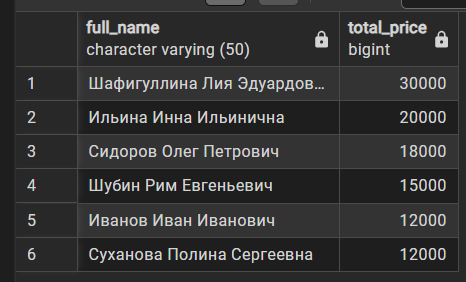

    1.2. Вывести имя тренера и количество тренировок, которые он провел. Высести только тех тренеров, у которых количество тренировок больше среднего количества тренировок по всем тренерам.

    WITH coach_workload AS 
        (SELECT coach_id, COUNT(*) AS total_trainings
        FROM training
        GROUP BY coach_id), 

        avg_workload AS 
        (SELECT AVG(total_trainings) AS avg_coaches_workload
        FROM coach_workload)

    SELECT c.full_name, cw.total_trainings
    FROM coach c
    INNER JOIN coach_workload cw ON cw.coach_id = c.coach_id
    CROSS JOIN avg_workload aw
    WHERE cw.total_trainings > aw.avg_coaches_workload; 

    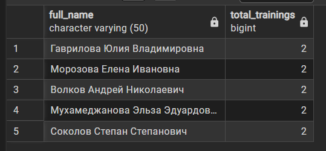

    1.3. Вывести названия залов, в которых прошло более двух тренировок, и общую длительность этих тренировок. Отсортировать по общей длительности по убыванию.

    WITH room_stats AS
        (SELECT room_id, COUNT(*) AS training_count, SUM(duration) AS total_duration
        FROM training
        GROUP BY room_id)

    SELECT room_name, rs.training_count, rs.total_duration
    FROM room r
    INNER JOIN room_stats rs ON rs.room_id = r.room_id
    WHERE rs.training_count > 2
    ORDER BY rs.total_duration DESC;

    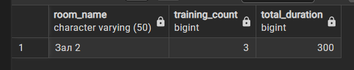

2. UNION - объединяет выполнение результатов и удаляет дубликаты (ALL не удаляет) 

    2.1. Вывести общий список имен и телефонов людей в клубе: тренера и клиенты. Отсортировать по алфовитному порядку имен.

    SELECT full_name, phone 
    FROM client
    UNION
    SELECT full_name, 'Нет номера телефона'
    FROM coach
    ORDER BY full_name;

    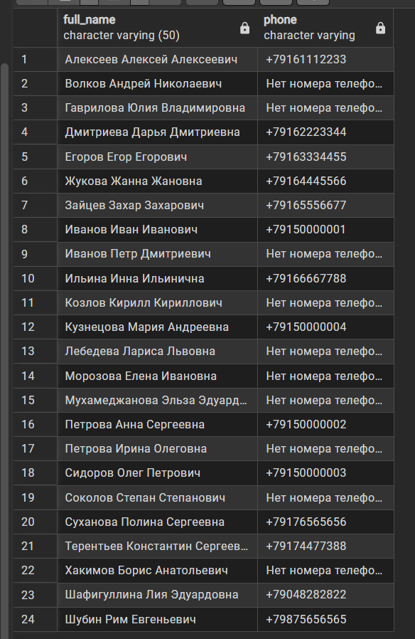    

3. INTERSECT - возвращает элементы из первого списка, которые имеют совпадения во втором элементе

    3.1. Вывести id клиентов, которые купили абонементы и посетили хотя бы одну тренировку. Отсортировать в неубывающем порядке.

    SELECT client_id 
    FROM membership
    INTERSECT 
    SELECT client_id
    FROM visit
    WHERE attended = true
    ORDER BY client_id;

    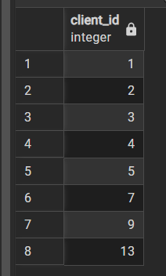

4. EXCEPT - возвращает элементы из первого списка, которые не имеют совпадения со вторым во втором элементе

    4.1. Вывести id клиентов, которые купили абонеметы, но не записывались на тренировки. Отсортировать по убыванию.

    SELECT client_id 
    FROM membership
    EXCEPT
    SELECT client_id
    FROM visit
    ORDER BY client_id DESC;

    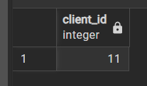

5. Оконные функции - PARTITION BY

    5.1. Вывести имя клиента, дату начала его абонемента и обую сумму, который потратил этот клиент на все свои абонементы. Отсортировать по алфавиту.

    SELECT c.full_name, m.start_date, 
    SUM(m.price) OVER
        (PARTITION BY m.client_id) AS total_sum
    FROM membership m
    JOIN client c ON c.client_id = m.client_id
    ORDER BY c.full_name;

    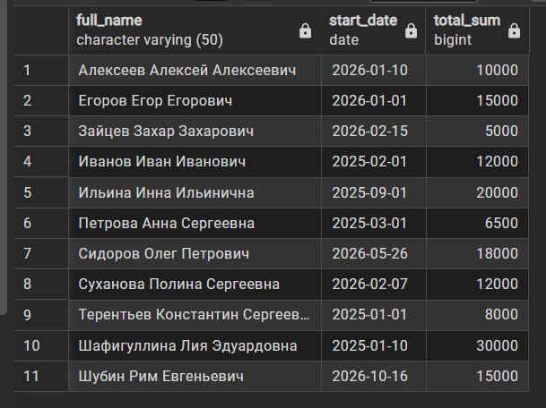

    5.2. Вывести название тренировки, ее длительность, среднюю длительность тренировки (у каждого тренера). Отсортировать по id тренера по возрастанию.

    SELECT coach_id, training_name, duration, 
    ROUND(AVG(duration) OVER
    (PARTITION BY coach_id), 2) AS avg_duration
    FROM training
    ORDER BY coach_id;

    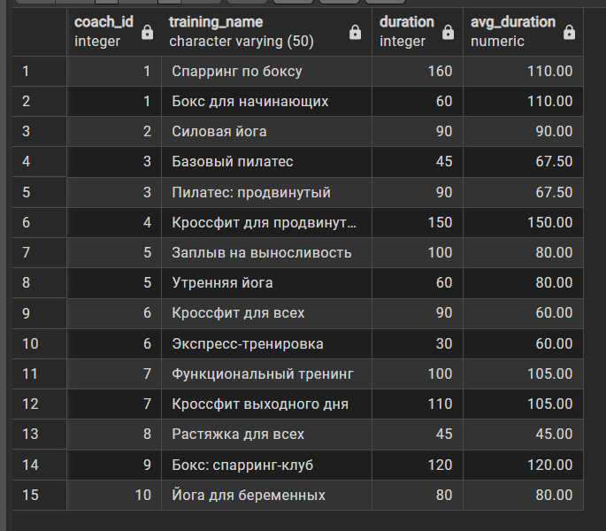

6. Оконные функции - PARTITION BY + ORDER BY

    6.1. Вывести id зала, название тренировки, длительность и накопительную сумму длительности тренировки, у каждого зала (от самой короткой до самой длинной). Отсортировать по номеру зала.

    SELECT room_id, training_name, duration,
    SUM(duration) OVER 
        (PARTITION BY room_id
        ORDER BY duration)
    FROM training 
    ORDER BY room_id;

    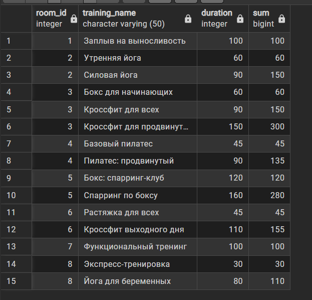

    6.2. Вывести id тренера, дату и время тренировки, накопительное количество тренировок, от первой (по времени) тренировки до последней. Отсортировать по id тренера.

    SELECT coach_id, datetime,
        COUNT(*) OVER
        (PARTITION BY coach_id
        ORDER BY datetime) AS running_count
    FROM training
    ORDER BY coach_id;

    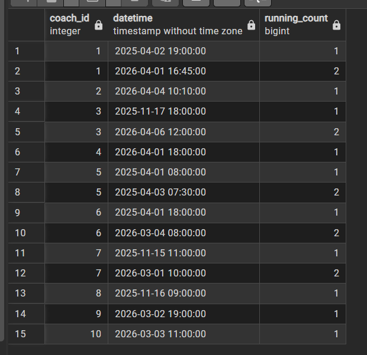

7. ROWS

    7.1. Для каждой тренировки вывести id зала, id тренировки, длительность и среднюю длительность этой и двух предыдущих тренировок (в том же зале, отсортированных по длительности). Отсортировать по id зала.

    SELECT room_id, training_id, duration, 
    ROUND(AVG(duration) OVER
        (PARTITION BY room_id
        ORDER BY duration
        ROWS BETWEEN 2 PRECEDING AND CURRENT ROW), 2) AS avg_last_3_trainings
    FROM training
    ORDER BY room_id;

    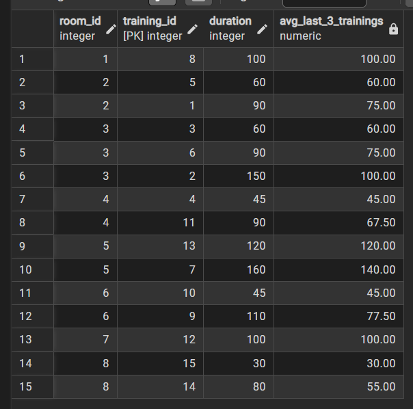

    7.2. Вывести id тренера, id трениировки, длительность и сумму длительности текущей и следующей за ней тренировкой (отдельно для каждого тренера, отсортировать id тренировки). Отсортировать по id тренера.

    SELECT coach_id, training_id, duration,
    SUM(duration) OVER
        (PARTITION BY coach_id
        ORDER BY training_id
        ROWS BETWEEN CURRENT ROW AND 1 FOLLOWING) AS sum_current_and_next_training
    FROM training
    ORDER BY coach_id;
    

    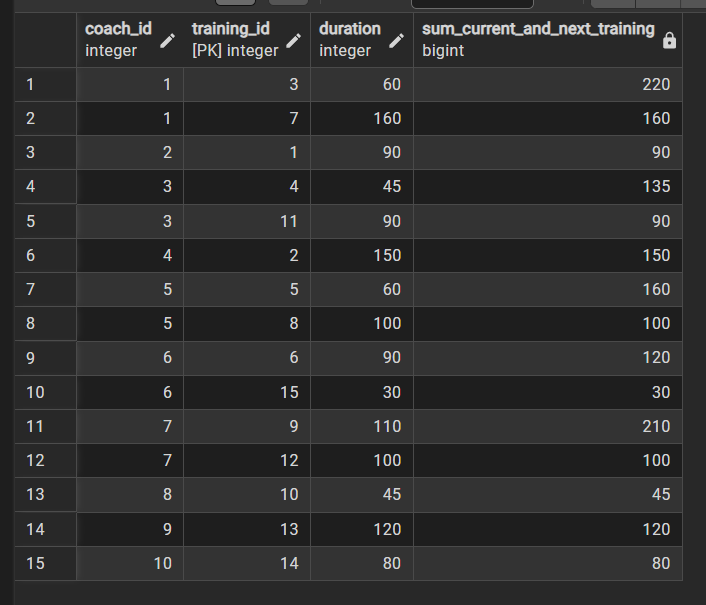

8. RANGE

    8.1. Вывести название тренировки, длительность и количество тренировок по всему клубу, длительность которых отличается от текущей не более чем на 15 минут (больше или меньше 15 минут). Отсортировать по названию тренировок в алфавитном порядке.

    SELECT training_name, duration,
    COUNT(*) OVER
        (ORDER BY duration
        RANGE BETWEEN 15 PRECEDING AND 15 FOLLOWING)
    FROM training
    ORDER BY training_name;

    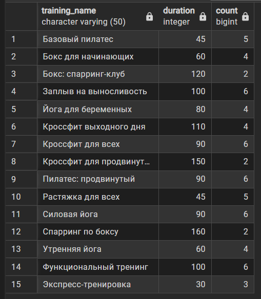

    8.2. Вывести id клиента, стоимость абонемента и сумму цен всех абонементов, стоимость которых отличается от текущего не более чем на 5000 рублей.

    SELECT client_id, price,
    SUM(price) OVER
        (ORDER BY price
        RANGE BETWEEN 5000 PRECEDING AND 5000 FOLLOWING)
    FROM membership;

    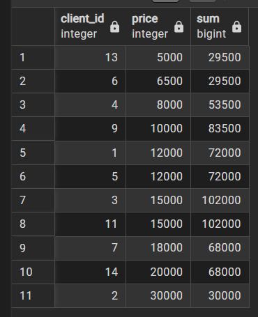

9. Ранжирующие оконные функции

    9.1. ROW_NUBER - нумерует

    Вывести id зала, название тренироки, ее длительность и порядковый номер по ее длительности (у каждого зала от короткой к длинной).Отсортировать по номеру зала.

    SELECT room_id, training_name, duration,
    ROW_NUMBER() OVER 
        (PARTITION BY room_id
        ORDER BY duration) AS place_in_room
    FROM training
    ORDER BY room_id;

    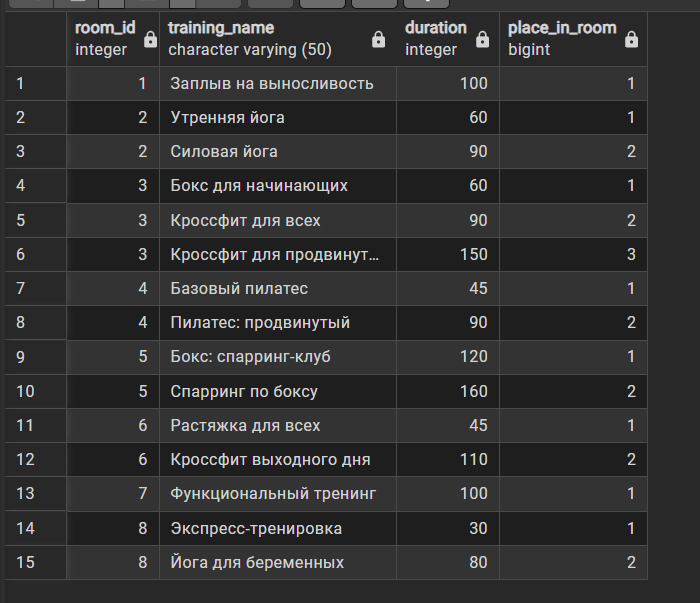

    9.2. RANK - по группам (если предыдущие были 3, 3, то следующий уже 5)

    Вывести название зала, вместимость и ранг зала по его вместимости (от большего к малому).

    SELECT room_name, capacity,
    RANK() OVER
        (ORDER BY capacity DESC)
    FROM room;

    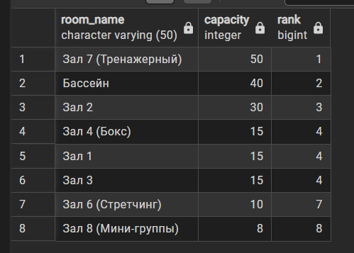

    9.3. DENSE_RANK - тоже самое, что и RANK, только не пропускает номера

    Вывести id клиента, цену и плотный ранг цены абонемента (от дорогой к дешевой).

    SELECT client_id, price,
    DENSE_RANK OVER
        (ORDER BY price DESC) 
    FROM membership;

    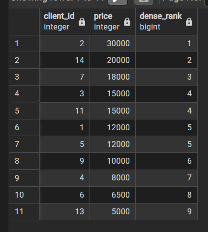

10. Оконные функции смещения

    10.1. LAG - предыдущее

    Вывести id клиента, id посещения и id предыдущего посещения этого же клиента. Отсортировать по id клиента и id посещения.

    SELECT client_id, visit_id,
    LAG(visit_id) OVER
        (PARTITION BY client_id
        ORDER BY visit_id)
    FROM visit
    ORDER BY client_id, visit_id;

    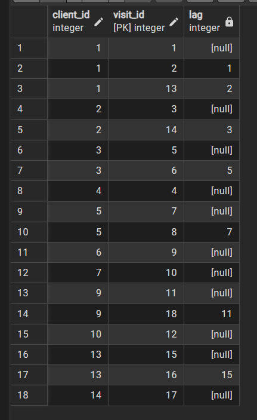

    10.2. LEAD - последующие

    Вывести id зала, id тренировки, datetime и datetime следующей тренировки, которая пройдет в этом же зале. Отсортировать по id комнаты и datetime.

    SELECT room_id, training_id, datetime,
    LEAD(datetime) OVER
        (PARTITION BY room_id
        ORDER BY datetime)
    FROM training
    ORDER BY room_id, datetime;

    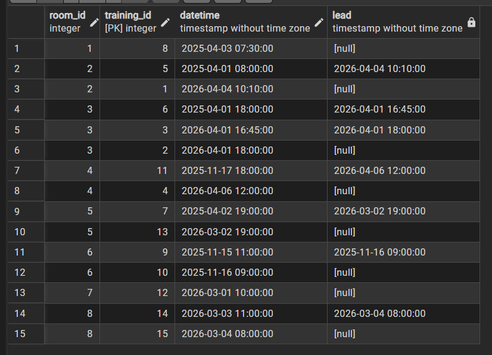

    10.3. FIRST_VALUE - первое значение в груупе

    Вывести id тренера, название тренировки, ее длительность и длительность самой первой тренировки (самой короткой) этого же тренера.

    SELECT coach_id, training_name, duration, 
    FIRST_VALUE(duration) OVER
        (PARTITION BY coach_id
        ORDER BY duration) AS min_duration_by_coach
    FROM training;

    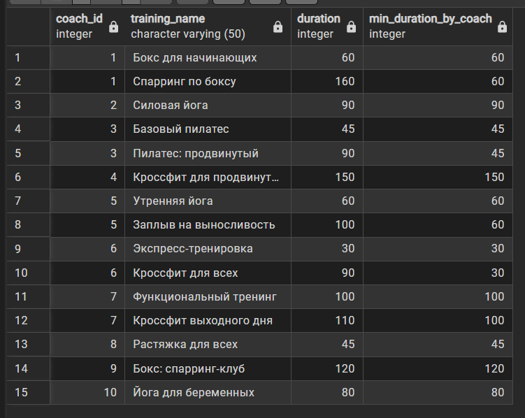

    10.4. LAST_VALUE - последнее значение в группе (нужно добавлять границу)

    Вывести id тренера, название тренировки ее длительность и длительность самой длинной тренировки этого же тренера.

    SELECT coach_id, training_name, duration, 
    LAST_VALUE(duartion) OVER
        (PARTITION BY coach_id
        ORDER BY duration
        ROWS BETWEEN UNBOUNDED PERCEDING AND UNBOUNDED FOLLOWING) AS max_duration_by_coach
    FROM training;

    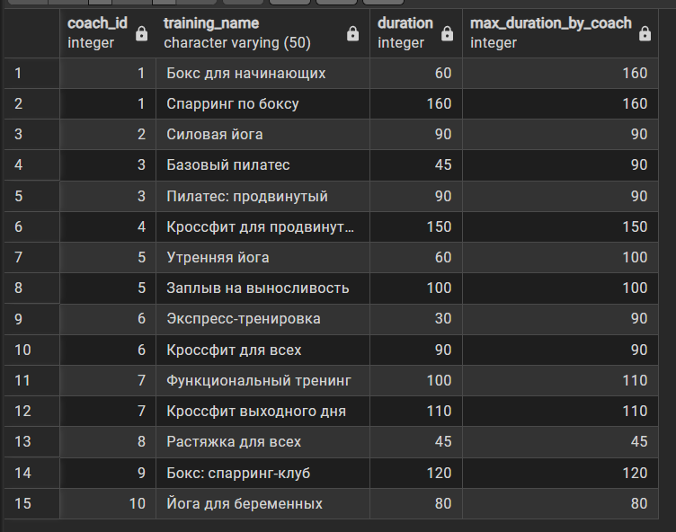