я немного хочу улучшить таблицы в бд, поэтому сюда прикреплю

новый скрипт:

-- 1. Клиенты
CREATE TABLE client (
    client_id SERIAL PRIMARY KEY,
    full_name VARCHAR(50),
    phone VARCHAR(20)
);

-- 2. Тренеры
CREATE TABLE coach (
    coach_id SERIAL PRIMARY KEY,
    full_name VARCHAR(50),
    specialization VARCHAR(50),
    age INT CHECK (age >= 18)
);

-- 3. Залы
CREATE TABLE room (
    room_id SERIAL PRIMARY KEY,
    room_name VARCHAR(50),
    capacity INT CHECK (capacity > 0)
);

-- 4. Абонементы
CREATE TABLE membership (
    membership_id SERIAL PRIMARY KEY,
    price INT CHECK (price > 0 AND price < 100000),
    start_date DATE,
    end_date DATE,
    client_id INT REFERENCES client(client_id) ON DELETE CASCADE,
    UNIQUE(client_id, start_date)
);

-- 5. Тренировки
CREATE TABLE training (
    training_id SERIAL PRIMARY KEY,
    training_name VARCHAR(50),
    duration INT CHECK (duration > 0 AND duration < 180),
    datetime TIMESTAMP,
    room_id INT REFERENCES room(room_id),
    coach_id INT REFERENCES coach(coach_id)
);

-- 6. Посещения
CREATE TABLE visit (
    visit_id SERIAL PRIMARY KEY,
    attended BOOLEAN,
    client_id INT REFERENCES client(client_id) ON DELETE CASCADE,
    training_id INT REFERENCES training(training_id) ON DELETE CASCADE
);

DML-скрипт:

-- 1. КЛИЕНТЫ

INSERT INTO client (full_name, phone) VALUES
('Суханова Полина Сергеевна',      '+79176565656'),
('Шафигуллина Лия Эдуардовна',     '+79048282822'),
('Шубин Рим Евгеньевич',           '+79875656565'),
('Терентьев Константин Сергеевич', '+79174477388'),
('Иванов Иван Иванович',           '+79150000001'),
('Петрова Анна Сергеевна',         '+79150000002'),
('Сидоров Олег Петрович',          '+79150000003'),
('Кузнецова Мария Андреевна',      '+79150000004'),
('Алексеев Алексей Алексеевич',    '+79161112233'),
('Дмитриева Дарья Дмитриевна',     '+79162223344'),
('Егоров Егор Егорович',           '+79163334455'),
('Жукова Жанна Жановна',           '+79164445566'),
('Зайцев Захар Захарович',         '+79165556677'),
('Ильина Инна Ильинична',          '+79166667788'),
('Козлова Ксения Кирилловна',      '+79167778899');

-- 2. ТРЕНЕРЫ

INSERT INTO coach (full_name, specialization, age) VALUES
('Мухамеджанова Эльза Эдуардовна', 'Бокс', 32),
('Иванов Петр Дмитриевич',         'Йога', 45),
('Гаврилова Юлия Владимировна',    'Пилатес', 27),
('Хакимов Борис Анатольевич',      'Кроссфит', 38),
('Морозова Елена Ивановна',        'Йога', 29),
('Волков Андрей Николаевич',       'Бокс', 41),
('Соколов Степан Степанович',      'Кроссфит', 35),
('Петрова Ирина Олеговна',         'Стретчинг', 28),
('Лебедева Лариса Львовна',        'Йога', 50),
('Смирнов Павел Павлович',         'Плавание', 22);

-- 3. ЗАЛЫ

INSERT INTO room (room_name, capacity) VALUES
('Бассейн', 40),
('Зал 1 (Кардио)', 15),
('Зал 2 (Кроссфит)', 30),
('Зал 3 (Йога)', 15),
('Зал 4 (Бокс)', 15),
('Зал 5 (Стретчинг)', 10),
('Зал 6 (Тренажерный)', 50);

-- 4. АБОНЕМЕНТЫ (11 штук)

INSERT INTO membership (price, start_date, end_date, client_id) VALUES
(12000, '2026-02-07', '2026-08-08', 1),
(30000, '2025-01-10', '2027-01-11', 2),
(15000, '2026-10-16', '2027-10-17', 3),
( 8000, '2025-01-01', '2025-04-01', 4),
(12000, '2025-02-01', '2025-08-01', 5),
( 6500, '2025-03-01', '2025-06-01', 6),
(18000, '2026-05-26', '2026-09-26', 7),
(25000, '2025-05-01', '2026-05-01', 9),
( 5000, '2025-06-01', '2025-12-01', 10),
(20000, '2025-09-01', '2026-03-01', 14);

INSERT INTO membership (price, start_date, end_date, client_id) VALUES
(10000, '2026-09-01', '2027-03-01', 1),
( 5000, '2027-01-12', '2027-06-01', 2),
(15000, '2026-06-01', '2027-01-01', 9);

-- 5. ТРЕНИРОВКИ

INSERT INTO training (training_name, duration, datetime, room_id, coach_id) VALUES
('Силовая йога',               90,  '2026-04-04 10:10', 4, 2),
('Кроссфит для продвинутых',  150,  '2026-04-01 18:00', 3, 4),
('Бокс для начинающих',        60,  '2026-04-01 16:45', 5, 1),
('Базовый пилатес',            45,  '2026-04-06 12:00', 4, 3),
('Утренняя йога',              60,  '2026-04-01 08:00', 4, 5),
('Кроссфит для всех',          90,  '2026-04-01 19:00', 3, 6),
('Спарринг по боксу',         160,  '2026-04-02 19:00', 5, 1),
('Заплыв на выносливость',    100,  '2026-04-03 07:30', 1, 10),
('Кроссфит выходного дня',    110,  '2026-11-15 11:00', 6, 7),
('Растяжка для всех',          45,  '2026-11-16 09:00', 6, 8),
('Пилатес: продвинутый',       90,  '2026-11-17 18:00', 4, 3),
('Аквааэробика',               55,  '2026-11-18 10:00', 1, 10),
('Функциональный тренинг',    120,  '2026-03-01 10:00', 7, 4),
('Йога для беременных',        80,  '2026-03-03 11:00', 6, 9),
('Экспресс-тренировка',        30,  '2026-03-04 08:00', 2, 6);

-- 6. ПОСЕЩЕНИЯ

INSERT INTO visit (attended, client_id, training_id) VALUES
(TRUE,  1, 1),
(TRUE,  1, 4), 
(FALSE, 2, 1), 
(FALSE, 3, 3), 
(TRUE,  3, 4),
(TRUE,  4, 2), 
(TRUE,  5, 5), 
(TRUE,  5, 6), 
(FALSE, 6, 6), 
(TRUE,  7, 7),
(TRUE,  9, 9), 
(TRUE, 9, 12),
(TRUE,  10, 9),
(TRUE,  13, 13), 
(TRUE, 13, 14),
(FALSE, 14, 14), 
(TRUE, 14, 2),
(TRUE,  15, 15), 
(FALSE, 15, 15),
(TRUE,  11, 5),
(TRUE,  12, 8),
(TRUE,  12, 12);

# Базовые операции с транзакциями

    ## Сценарий 1

    1.1. Написть транзакцию, которая добавляет нового клиента, а затем сразу оформляет ему абонемент. 
    Во второй транзакции проверить, что обе записи сохранились и они связаны по внешнему ключу.

    ### T1

        BEGIN;
            -- добавление нового клиента
            INSERT INTO client (full_name, phone)
            VALUES ('Белова Татьяна Евгеньевна', '+79047197070');

            -- оформление абонемента данному клиенту 
            INSERT INTO membership (price, start_date, end_date, client_id)
            VALUES (50000, '2026-11-18', '2027-11-18', (SELECT client_id FROM client WHERE full_name = 'Белова Татьяна Евгеньевна' AND phone = '+79047197070'));
        COMMIT;

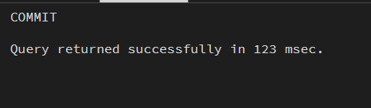

        ожидается, что сохранится новый пользователь с абонементом, привязанным к этому пользователю

    ### T2

        -- проверка того, что пользователь сохранен
        SELECT c.client_id, c.full_name, m.price
        FROM client c
        JOIN membership m ON c.client_id = m.client_id
        WHERE m.client_id = (SELECT client_id FROM client WHERE full_name = 'Белова Татьяна Евгеньевна' AND phone = '+79047197070');

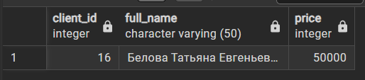

        мои ожидания подтвердились, пользователь сохранен и сразу создался его абонемент 

    1.2. Теперь вместо COMMIT делаем ROLLBAKC

    ### T1

        BEGIN;
            -- добавление нового клиента
            INSERT INTO client (full_name, phone)
            VALUES ('Семенов Павел Андреевич', '+79047197080');

            -- оформление абонемента данному клиенту 
            INSERT INTO membership (price, start_date, end_date, client_id)
            VALUES (50000, '2026-11-18', '2027-11-18', (SELECT client_id FROM client WHERE full_name = 'Семенов Павел Андреевич' AND phone = '+79047197080'));
        ROLLBACK;

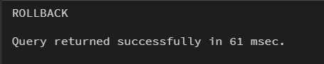

        ожидается, что новый пользователь с абонементом, привязанным к этому пользователю не сохранятся

    ### T2

        -- проверка того, что пользователь сохранен
        SELECT c.client_id, c.full_name, m.price
        FROM client c
        JOIN membership m ON c.client_id = m.client_id
        WHERE m.client_id = (SELECT client_id FROM client WHERE full_name = 'Семенов Павел Андреевич' AND phone = '+79047197080');

        мои ожидания подтвердились, пользователь не сохранен и его абонемент не создался

    1.3. Написть транзакцию, которая добавляет новый зал, а затем попробовать поделить число на 0.

    ### T1

        BEGIN;
            -- добавление нового зала
            INSERT INTO room (room_name, capacity)
            VALUES ('Ошибочный зал', 25);

            -- делим число на 0
            SELECT 25 / 0;
        COMMIT;

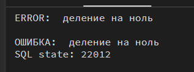

        ожидается, что зал не сохранится из-за некорректного деления

    ### T2

        -- проверка того, что зал не сохранен
        SELECT * FROM room
        WHERE room_name = 'Ошибочный зал';

        мои ожидания подтвердились, зал не сохранился

    ## Сценарий 2
    
    1.1. Написть транзакцию, которая добавляет нового тренера, а затем сразу назначает ему тренировку. 
    Во второй транзакции проверить, что обе записи сохранились и они связаны по внешнему ключу.

    ### T1

        BEGIN;
            -- добавление нового тренера
            INSERT INTO coach (full_name, specialization, age)
            VALUES ('Куликова Мария Григорьевна', 'Йога', 36);

            -- назначает данному тренеру тренеровку
            INSERT INTO training (training_name, duration, datetime, room_id, coach_id)
            VALUES ('Йога с щенятами', 70, '2026-11-18 20:00', 2, (SELECT c.coach_id FROM coach c WHERE c.full_name = 'Куликова Мария Григорьевна' AND c.specialization = 'Йога' AND c.age = 36));
        COMMIT;

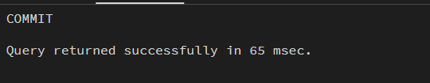

        ожидается, что сохранится новый тренер и появится его тренировка

    ### T2

        -- проверка того, что тренер сохранен
        SELECT c.full_name, c.specialization, t.training_name, t.duration
        FROM coach c
        JOIN training t ON c.coach_id = t.coach_id
        WHERE t.coach_id = (SELECT c.coach_id FROM coach c WHERE c.full_name = 'Куликова Мария Григорьевна' AND c.specialization = 'Йога' AND c.age = 36);

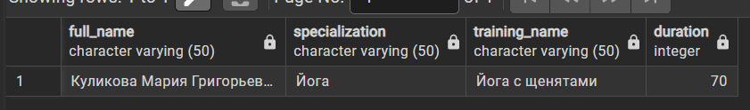

        мои ожидания подтвердились, тренер сохранен и сразу создалась его тренировка 

    1.2. Теперь вместо COMMIT делаем ROLLBAKC

    ### T1

        BEGIN;
            -- добавление нового тренера
            INSERT INTO coach (full_name, specialization, age)
            VALUES ('Шибанов Михаил Владимирович', 'Тайский бокс', 38);

            -- назначает данному тренеру тренеровку
            INSERT INTO training (training_name, duration, datetime, room_id, coach_id)
            VALUES ('Тайский бокс', 90, '2027-11-18 20:00', 2, (SELECT c.coach_id FROM coach c WHERE c.full_name = 'Шибанов Михаил Владимирович' AND c.specialization = 'Тайский бокс' AND c.age = 38));
        ROLLBACK;

        
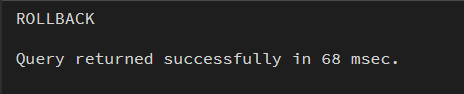

        ожидается, что сохранится новый тренер не сохранится

    ### T2

        -- проверка того, что тренер сохранен
        SELECT c.full_name, c.specialization, t.training_name, t.duration
        FROM coach c
        JOIN training t ON c.coach_id = t.coach_id
        WHERE t.coach_id = (SELECT c.coach_id FROM coach c WHERE c.full_name = 'Шибанов Михаил Владимирович' AND c.specialization = 'Тайский бокс' AND c.age = 38);

        мои ожидания подтвердились, тренер не сохранен

    1.3. Написть транзакцию, которая добавляет новый зал, а затем попробовать добавить тренера, которому меньше 18 лет.

    ### T1

        BEGIN;
            -- добавление нового зала
            INSERT INTO room (room_name, capacity)
            VALUES ('Ошибочный зал', 25);

            -- добавляем тренера, которому меньше 18 лет
            INSERT INTO coach (full_name, specialization, age)
            VALUES ('Соболев Иван Петрович', 'Тайский бокс', 16);
        COMMIT;

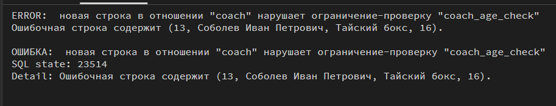

        ожидается, что зал не сохранится из-за некорректного создания тренера

    ### T2

        -- проверка того, что зал не сохранен
        SELECT * FROM room
        WHERE room_name = 'Ошибочный зал';

    

        мои ожидания подтвердились, зал не сохранился

**Результаты.** При `COMMIT` обе связанные записи сохранялись и связывались по внешнему ключу (JOIN во второй сессии это подтверждал). При `ROLLBACK` ни клиент с абонементом, ни тренер с тренировкой не сохранялись. Если в транзакции возникает ошибка (деление на 0 или нарушение CHECK на возраст тренера), вся транзакция прерывается, и даже корректные предыдущие `INSERT` (новый зал) не фиксируются - атомарность подтверждена.

# Уровни изоляции

    ## Сценарий 1

    2.1. READ UNCOMMITTED - T1 пытается прочитать данные, которые T2 изменила, но еще не сохранила (тк пишу в PostgreSQL, нужно убедиться, что "грязное" чтение не допускается).

        ### T1

        BEGIN ISOLATION LEVEL READ COMMITTED;

        -- прочитать текущую стоимость абонемента (membership_id = 1)
        SELECT price FROM membership WHERE membership_id = 1;

        ### T2

        BEGIN;

        -- меняем цену на 99999, но не сохраняем
        UPDATE membership SET price = 99999 WHERE membership_id = 1;

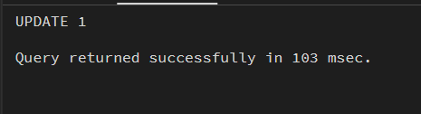

         ### T1

        -- еще раз прочитать текущую стоимость абонемента (membership_id = 1)
        SELECT price FROM membership WHERE membership_id = 1;

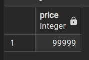

        COMMIT;

    

    2.2. READ COMMITTED - Если T1 изменила данные, но не сделала COMMIT, то T2 не увидит этих изменений.

        ### T1

        BEGIN;

        -- меняем цену абонемента
        UPDATE membership SET price = 55555 WHERE membership_id = 2;     

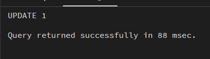

        ожидается, что "грязное" чтение не произойдет и мы увидим в T2 старую стоимость абонемента

        ### T2

        SELECT price FROM membership WHERE membership_id = 2;

        ожидания подтвердились, вывелась прежняя стоимость абонемента

    2.3. READ COMMITTED - T2 может изменить данные так, что T1 увидит это посреди работы.

        ### T1

        BEGIN ISOLATION LEVEL READ COMMITTED;

        -- смотрим цену абонемента
        SELECT price FROM membership WHERE membership_id = 3;

        увидим изначальную цену абонемента

        ### T2 - обновляем цену данного абонемента и делаем COMMIT

        BEGIN;
        UPDATE membership SET price = 77777 WHERE membership_id = 3;
        COMMIT;

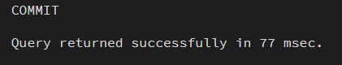

        обновляем стоимость просмотренного абонемента

        ### T1 - еще раз смотрим цену абонемента и делаем COMMIT

        SELECT price FROM membership WHERE membership_id = 3;

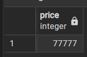

        увидим обновленную цену абонемента - 77777

        COMMIT;

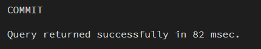

     ## Сценарий 2

    2.1. READ UNCOMMITTED - T1 пытается прочитать данные, которые T2 изменила, но еще не сохранила (тк пишу в PostgreSQL, нужно убедиться, что "грязное" чтение не допускается).

        ### T1

        BEGIN ISOLATION LEVEL READ COMMITTED;

        -- посмотреть количество тренеров
        SELECT COUNT(*) FROM coach;

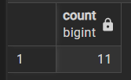

        посмотрели количество тренеров, после T2 мы должны увидеть то же самое количество тренеров

        ### T2

        BEGIN;

        -- добавляем нового тренера
        INSERT INTO coach (full_name, specialization, age)
        VALUES ('Литвинова Елена Юрьевна', 'Каратэ', 29);

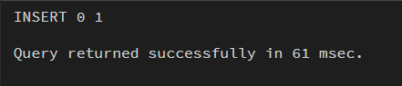

         ### T1

        -- еще раз посмотреть количество тренеров
        SELECT COUNT(*) FROM coach;

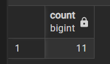

        COMMIT;

        ожидания подтвердились, мы получили то же самое количество тренеров

    

    2.2. "Фантомное" чтение

        ### T1

        BEGIN ISOLATION LEVEL READ COMMITTED;

        -- посчитать количество посещений клиента (client_id = 3)
        SELECT COUNT(*) FROM visit v WHERE v.client_id = 3;     

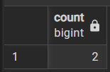

        

        ### T2

        BEGIN;
            INSERT INTO visit (attended, client_id, training_id) VALUES (TRUE, 3, 6);
        COMMIT;

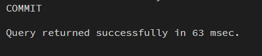

        

        ### T1

        -- посчитать количество посещений клиента (client_id = 3)
        SELECT COUNT(*) FROM visit v WHERE v.client_id = 3;  

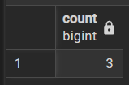  

        COMMIT;

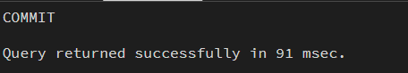

    2.3. READ COMMITTED - T2 может изменить данные так, что T1 увидит это посреди работы.

        ### T1

        BEGIN ISOLATION LEVEL READ COMMITTED;

        -- смотрим телефон клиента
        SELECT phone FROM client WHERE client_id = 1;

        увидим изначальный телефон клиента

        ### T2 - обновляем телефон данного клиента и делаем COMMIT

        BEGIN;
        UPDATE client SET phone = '+79998887766' WHERE client_id = 1;
        COMMIT;

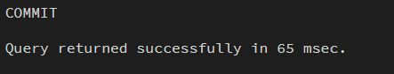

        обновляем телефон просмотренного клиента

        ### T1 - еще раз смотрим телефон клиента

        SELECT phone FROM client WHERE client_id = 1;

        увидим обновленный телефон клиента - +79998887766

        COMMIT;

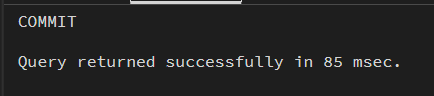

# REPEATABLE READ

    ## Сценарий 1

        3.1. T1 смотрит телефон клиента, затем T2 изменяет телефон этого пользователя, но не делает COMMIT, затем T1 снова смотрит телефон клиента. И T2 делает COMMIT. Теперь T1 видит изменение, после своего COMMIT.

        ### T1

        BEGIN ISOLATION LEVEL REPEATABLE READ;
        
        -- смотрим телефон клиента (client_id = 1)
        SELECT phone FROM client WHERE client_id = 1;

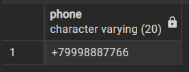

        ### T2 

        BEGIN;

        -- изменяем телефон пользователя
        UPDATE client SET phone = '+71111111111' WHERE client_id = 1;

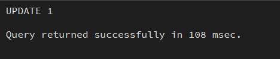

        ### T1 

        -- снова смотрим телефон клиента (client_id = 1)
        SELECT phone FROM client WHERE client_id = 1;

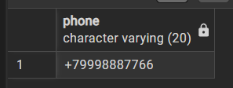

        ### T2

        COMMIT;

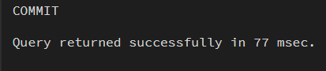

        ### T1 

        COMMIT;

        -- смотрим телефон клиента (client_id = 1)
        SELECT phone FROM client WHERE client_id = 1;

        
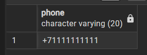

       3.2.  T1 смотрит количество клиентов, затем T2 добавляет нового пользователя и делает COMMIT, затем T1 снова смотрит количество клиент и делает COMMIT. Теперь T1 видит изменение.

        ### T1

        BEGIN ISOLATION LEVEL REPEATABLE READ;
        
        -- смотрим количество клиентов
        SELECT COUNT(*) clients_count FROM client;

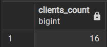

        ### T2 

        BEGIN;

        -- добавляем нового пользователя
        INSERT INTO client (full_name, phone)
        VALUES ('Арефьева Ольга Кирилловна', '+78005553535');

        COMMIT;

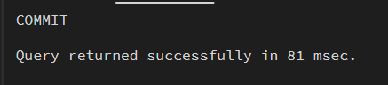

        ### T1 

        -- снова смотрим количество клиентов
        SELECT COUNT(*) clients_count FROM client;

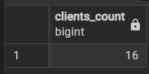

        COMMIT;

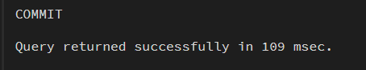

         -- смотрим количество клиентов
        SELECT COUNT(*) clients_count FROM client;

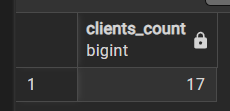

        "Фантомное" чтение не произошло

    ## Сценарий 2

          3.1. T1 смотрит возраст тренера, затем T2 изменяет возраст этого тренера, но не делает COMMIT, затем T1 снова смотрит возраст тренера. И T2 делает COMMIT. 

         ### T1

        BEGIN ISOLATION LEVEL REPEATABLE READ;
        
        -- смотрим возраст тренера (coach_id = 5)
        SELECT age FROM coach WHERE coach_id = 5;

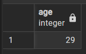

        ### T2 

        BEGIN;

        -- изменяем возраст тренера
        UPDATE coach SET age = 50 WHERE coach_id = 5;

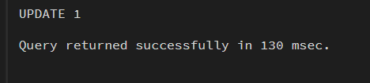

        ### T1 

        -- снова смотрим возраст тренера (coach_id = 5)
        SELECT age FROM coach WHERE coach_id = 5;

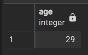

        ### T2

        COMMIT;

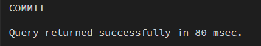

         ### T1 

        COMMIT;

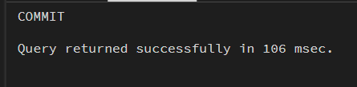

        -- смотрим возраст тренера (coach_id = 5)
        SELECT age FROM coach WHERE coach_id = 5;

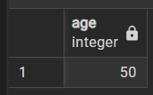

        3.2. T1 смотрит количество абонементов, затем T2 добавляет новый абонемент и делает COMMIT, затем T1 снова смотрит количество абонементов и делает COMMIT. Теперь T1 видит изменение.

            ### T1

            BEGIN ISOLATION LEVEL REPEATABLE READ;
            
            -- смотрим количество абонементов
            SELECT COUNT(*) clients_count FROM membership;

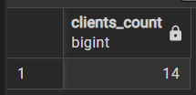

            ### T2 

            BEGIN;

            -- добавляем нового пользователя
            INSERT INTO membership (price, start_date, end_date, client_id)
            VALUES (99999, '2027-01-01', '2028-01-01', 1);

            COMMIT;

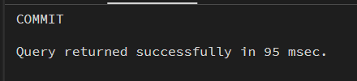

            ### T1 

            -- снова смотрим количество абонементов
            SELECT COUNT(*) clients_count FROM membership;

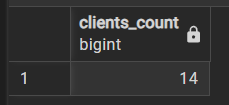

            COMMIT;

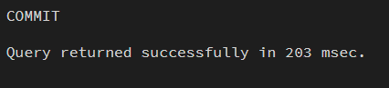

            -- смотрим количество абонементов
            SELECT COUNT(*) clients_count FROM membership;

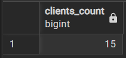

            "Фантомное" чтение не произошло

**Вывод.** PostgreSQL реализует REPEATABLE READ через изоляцию снимков: транзакция фиксирует снимок при первом чтении и читает только его до конца. Поэтому на этом уровне не возникают ни неповторяющееся чтение, ни фантомы.

# SERIALIZABLE

    ## Сценарий 1

    4.1. У клиента нет абонемента, T1 проверяет и добавляет данному клиенту абонемент. Затем T2 тоже проверяет, есть ли у данного клиента абонемент, и после T1 COMMIT, T2 тоже пытается добавить этому клиенту абонемент.
    
        ### T1 

        BEGIN ISOLATION LEVEL SERIALIZABLE;

        SELECT 1 FROM membership WHERE client_id = 8;

        
        INSERT INTO membership (price, start_date, end_date, client_id)
        VALUES (99999, '2027-01-01', '2028-01-01', 8);

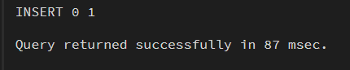

         ### T2

        BEGIN ISOLATION LEVEL SERIALIZABLE;

        SELECT 1 FROM membership WHERE client_id = 8;
        

        ### T1 

        COMMIT;

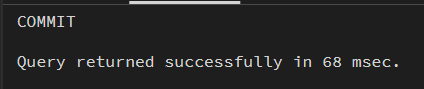

        ### T2

        INSERT INTO membership (price, start_date, end_date, client_id)
        VALUES (99999, '2027-01-01', '2028-01-01', 8);

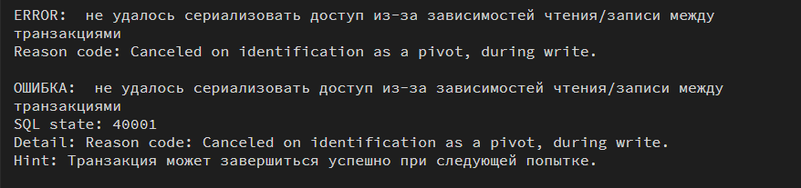

    4.2. делаем RETRY транзакцию. Через T2 проверяем, есть ли у клиента абонемент (он уже будет существовать), и закрываем транзакцию.

         ### T2

        BEGIN ISOLATION LEVEL SERIALIZABLE;

        SELECT 1 FROM membership WHERE client_id = 8;

        COMMIT;    

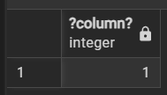

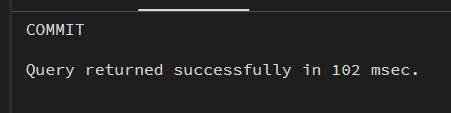

    ## Сценарий 2

    4.1. T1 и T2 одновременно планируют разные тренировки в зале 5 (бокс, вместимость 15) на пересекающееся время. Каждый перед вставкой проверяет: в этом зале в это время ничего нет. Обе проверки дают 0 строк, обе вставки логически допустимы - но вместе они нарушают бизнес-правило: в одном зале не может быть двух тренировок одновременно. Расписание становится некорректным.
    
        ### T1 

        BEGIN ISOLATION LEVEL SERIALIZABLE;

        SELECT 1 FROM training WHERE room_id = 5 AND datetime = '2027-08-02 19:00';

        
        INSERT INTO training (training_name, duration, datetime, room_id, coach_id)
        VALUES ('Бокс', 90, '2027-08-02 19:00', 5, 1);

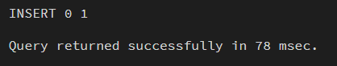

         ### T2

        BEGIN ISOLATION LEVEL SERIALIZABLE;

        SELECT 1 FROM training WHERE room_id = 5 AND datetime = '2027-08-02 19:00';
        

        ### T1 

        COMMIT;

        ### T2

         INSERT INTO training (training_name, duration, datetime, room_id, coach_id)
        VALUES ('Бокс', 70, '2027-08-02 19:00', 5, 2);

    4.2. делаем RETRY транзакцию. Через T2 проверяем, есть ли у в зале тренировка (она уже будет существовать), и закрываем транзакцию.

         ### T2

        BEGIN ISOLATION LEVEL SERIALIZABLE;

        SELECT 1 FROM training WHERE room_id = 5 AND datetime = '2027-08-02 19:00';

        COMMIT;    

**Вывод.** При повторе транзакция видит актуальное состояние и завершается корректно.

# SAVEPOINT

    ## Сценарий 1

        5.1. Вносим два измененияЖ добавляем клиентаь меняем его телефон, ставим SAVEPOINT, добавляем абонемент новому клиенту, откатываем к точке сохранения. Проверяем: изменения до SAVEPOINT остались (клиент и новый телефон), после - откатились (абонемент клиента).

        BEGIN;

            INSERT INTO client (full_name, phone)
            VALUES ('Мишкина Анна Семеновна', '+72222222222');

            UPDATE client SET phone = '+72222222223' WHERE client_id = (SELECT c.client_id FROM client c WHERE full_name = 'Мишкина Анна Семеновна' AND phone = '+72222222222');

            SAVEPOINT sp_check;

            INSERT INTO membership (price, start_date, end_date, client_id)
            VALUES (9999, '2027-01-01', '2028-01-01', (SELECT c.client_id FROM client c WHERE full_name = 'Мишкина Анна Семеновна' AND phone = '+72222222223'));

            ROLLBACK TO SAVEPOINT sp_check;

            -- проверка: клиент и новый телефон остались, абонемента нет
            SELECT * FROM client WHERE full_name = 'Мишкина Анна Семеновна';
            SELECT phone FROM client WHERE client_id =  (SELECT c.client_id FROM client c WHERE full_name = 'Мишкина Анна Семеновна' AND phone = '+72222222223');    
            SELECT * FROM membership WHERE client_id =  (SELECT c.client_id FROM client c WHERE full_name = 'Мишкина Анна Семеновна' AND phone = '+72222222223');   

    

        COMMIT;

        

        -- финальная проверка после COMMIT: то же самое состояние
        SELECT * FROM client WHERE full_name = Мишкина Анна Семеновна';

        5.2. Добавляем тренера → sp1 → меняем возраст тренера → sp2 → меняем специализацию тренера. Сначала откат к sp2 (отменяется только третье), затем к sp1 (отменяется и второе). Потом демонстрируем, что sp2 после отката к sp1 недействителен.

        BEGIN;

        -- добавляем тренера
        INSERT INTO coach (full_name, specialization, age)
        VALUES ('Михайлов Андрей Петрович', 'Пилатес', 39);

        SAVEPOINT sp1;

        --меняем возраст тренера
        UPDATE coach SET age = 30 WHERE coach_id = (SELECT c.coach_id FRON coach c WHERE c.full_name = 'Михайлов Андрей Петрович');

        SAVEPOINT sp2;

        -- меняем специализацию тренера
        UPDATE coach SET specialization = 'Плавание' WHERE coach_id = (SELECT c.coach_id FROM coach c WHERE c.full_name = 'Михайлов Андрей Петрович');

        -- проверяем текущее состояние (все три изменения видны)
        SELECT * FROM coach WHERE full_name = 'Михайлов Андрей Петрович';

        -- откат к sp2: отменяется только изменение 3
        ROLLBACK TO SAVEPOINT sp2;
        SELECT full_name, age, cpecialization FROM coach WHERE coach_id = (SELECT c.coach_id FROM coach c WHERE c.full_name = 'Михайлов Андрей Петрович');

        -- откат к sp1: отменяется и изменение 2
        ROLLBACK TO SAVEPOINT sp1;
        SELECT full_name, age, cpecialization FROM coach WHERE coach_id (SELECT c.coach_id FROM coach c WHERE c.full_name = 'Михайлов Андрей Петрович');

        -- sp2 после отката к sp1 больше не существует: попробуем откатиться на него
         ROLLBACK TO SAVEPONT sp2;

         ROLLBACK;

         SELECT * FROM coach WHERE full_name = 'Михайлов Андрей Петрович';

    ## Сценарий 2

        5.1. Добавляем клиенту 8 абонемент, делаем SAVEPOINT, после добавляем запись о посещении тренировки и изменяем цену абонемента, затем выполняем ROLLBACK TO SAVEPOINT. 

            BEGIN;

            -- добавляем абонемент клиенту 8
            INSERT INTO membership (price, start_date, end_date, client_id)
            VALUES (12000, '2027-02-01', '2027-08-01', 8);

            SAVEPOINT sp_abonement;

            --  добавляем посещение тренировки 2 клиентом 8
            INSERT INTO visit (attended, client_id, training_id)
            VALUES (TRUE, 8, 2);

            -- меняем цену абонемента
            UPDATE membership SET price = 15000
            WHERE client_id = 8 AND start_date = '2027-02-01';

            -- все три изменения видны внутри транзакции

            -- price = 15000
            SELECT * FROM membership WHERE client_id = 8; 

             -- строка есть
            SELECT * FROM visit WHERE client_id = 8;

            -- откат к точке
            ROLLBACK TO SAVEPOINT sp_abonement;

            COMMIT;

        
            -- абонемент ЕСТЬ, price = 12000 (исходная)
            SELECT * FROM membership WHERE client_id = 8; 

            -- посещение откатилось 
            SELECT * FROM visit WHERE client_id = 8;   

        5.2.  добавляем зал → SAVEPOINT sp1 → добавляем тренировку в новый зал → SAVEPOINT sp2 → продлеваем эту тренировку. Сначала ROLLBACK TO sp2 — отменяется только изменение 3. Затем ROLLBACK TO sp1 — отменяется и изменение 2, но изменение 1 остаётся.

            BEGIN;

            -- добавляем зал
            INSERT INTO room (room_name, capacity) VALUES ('Зал 8 (Растяжка)', 12);

            SAVEPOINT sp1;

            -- добавляем тренировку в новый зал
            INSERT INTO training (training_name, duration, datetime, room_id, coach_id)
            VALUES ('Стретчинг-час', 45, '2027-09-01 09:00', (SELECT room_id FROM room WHERE room_name = 'Зал 8 (Растяжка)'), 8);

            SAVEPOINT sp2;

            -- продлеваем эту тренировку
            UPDATE training SET duration = 90
            WHERE training_name = 'Стретчинг-час' AND room_id = 1;

            -- все три изменения видны
            SELECT * FROM training WHERE training_name = 'Стретчинг-час';

            -- откат к sp2
            ROLLBACK TO SAVEPOINT sp2;

             -- 45
            SELECT duration FROM training WHERE training_name = 'Стретчинг-час';

            -- зал на месте
            SELECT * FROM room WHERE room_name = 'Зал 8 (Растяжка)';  

            -- откат к sp1
            ROLLBACK TO SAVEPOINT sp1;

            SELECT * FROM training WHERE training_name = 'Стретчинг-час';

             -- зал остался
            SELECT * FROM room WHERE room_name = 'Зал 8 (Растяжка)';

            -- sp2 после отката к sp1 больше не существует
            ROLLBACK TO SAVEPOINT sp2;

            

            ROLLBACK;

            SELECT * FROM room WHERE room_name = 'Зал 8 (Растяжка)';

**Вывод.** `SAVEPOINT` позволяет отменять часть изменений без отмены всей транзакции: `ROLLBACK TO SAVEPOINT` отменяет изменения и все более поздние точки, `ROLLBACK` отменяет всю транзакцию целиком.

## Общие выводы

1. Транзакции атомарны: ошибка любого оператора (или `ROLLBACK`) отменяет всю работу, `COMMIT` фиксирует её окончательно.
2. В PostgreSQL «грязное» чтение невозможно ни на каком уровне; READ UNCOMMITTED работает как READ COMMITTED.
3. READ COMMITTED допускает неповторяющееся и фантомное чтение; 
4. SERIALIZABLE отлавливает логические конфликты, где обе транзакции по отдельности корректны, но вместе нарушают бизнес-правило: проигравшая получает SQLSTATE 40001, восстановление - только retry транзакции.
5. SAVEPOINT даёт частичный откат внутри транзакции; после отката к ранней точке более поздние точки становятся недействительными, а полный `ROLLBACK` отменяет всё без исключений.
