# 1 ПРОЦЕДУРЫ

    1) Процедура добавления нового клиента: создается клиент и вместе с ним его абонемент, дата конца абонемента рассчитывается так: дата начала + 1 год.
    
    
    CREATE OR REPLACE PROCEDURE add_new_client(
        client_full_name VARCHAR(50),
        client_phone VARCHAR(20), 
        membership_price INT, 
        membership_start_date DATE
    )
    LANGUAGE plpgsql
    AS $$
    DECLARE
        new_client_id INT;
    BEGIN

        IF membership_price <= 0 THEN
            RAISE EXCEPTION 'Ошибка: цена должна быть больше нуля!';
        END IF;

        IF membership_price >= 100000 THEN
            RAISE EXCEPTION 'Ошибка: цена не может быть больше 100 000!';
        END IF;

        INSERT INTO client (full_name, phone)
        VALUES (client_full_name, client_phone)
        RETURNING client_id INTO new_client_id;

        INSERT INTO membership (price, start_date, end_date, client_id)
        VALUES (membership_price, membership_start_date, membership_start_date + INTERVAL '1 year', new_client_id);
    END;
    $$;

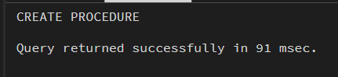

    ### ПРОВЕРКА
    CALL add_new_client('Шахнович Евгения Владимировна', '+79990001122', 15000, '2026-01-01');

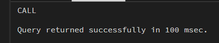

    SELECT c.full_name, c.phone, m.price
    FROM client c
    JOIN membership m ON c.client_id = m.client_id
    WHERE c.phone =  '+79990001122';

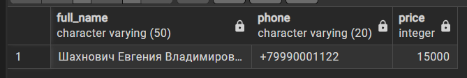

    2) Процедура изменения цены абонемента (проверить допустимое ли значение передано).

    CREATE OR REPLACE PROCEDURE update_membership_price(
        update_membership_id INT,
        new_membership_price INT
    )
    LANGUAGE plpgsql
    AS $$
    BEGIN
        IF new_membership_price <= 0 THEN
            RAISE EXCEPTION 'Ошибка: цена должна быть больше нуля!';
        END IF;

        IF new_membership_price >= 100000 THEN
            RAISE EXCEPTION 'Ошибка: цена не может быть больше 100 000!';
        END IF;

        UPDATE membership SET price = new_membership_price WHERE membership_id = update_membership_id;
    END;
    $$;

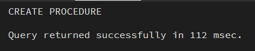

    ### ПРОВЕРКА
    CALL update_membership_price(1, 25000);

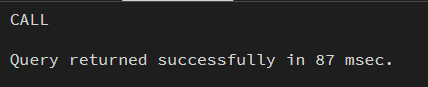

    SELECT membership_id, price
    FROM membership
    WHERE membership_id = 1;

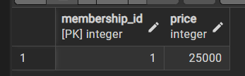

    CALL update_membership_price(1, -25000);

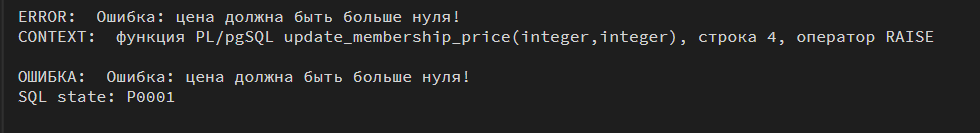

    3) Процедура добавления нового зала (проверить вместимость).

    CREATE OR REPLACE PROCEDURE add_room(
        new_room_name VARCHAR(50),
        new_capacity INT
    )
    LANGUAGE plpgsql
    AS $$
    BEGIN
        IF new_capacity <= 0 THEN
            RAISE EXCEPTION 'Ошибка: вместимость должна быть больше нуля!';
        END IF;

        INSERT INTO room (room_name, capacity)
        VALUES (new_room_name, new_capacity);
    END;
    $$;

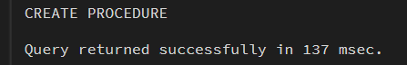

    ### ПРОВЕРКА
    CALL add_room('Хореографический зал', 36);

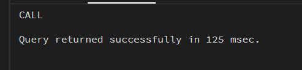

    4) Вывод всех созданных процедур.

    SELECT routine_name, routine_type
    FROM information_schema.routines
    WHERE routine_type = 'PROCEDURE' AND routine_schema = 'public';

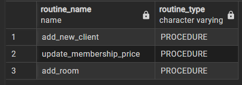

# 2.1. ФУНКЦИИ

    1) Функция, которая возвращает количество клиентов в базе.

    CREATE OR REPLACE FUNCTION get_client_count()
    RETURNS INT
    LANGUAGE plpgsql
    AS $$
    BEGIN
        RETURN COUNT(*) FROM client;
    END;
    $$;

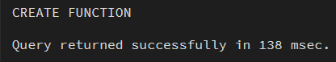

    ### ПРОВЕРКА
    SELECT get_client_count();

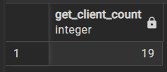

    2) Функция, которая возвращает самую дорогую стоимость абонемента.

    CREATE OR REPLACE FUNCTION get_max_price()
    RETURNS INT
    LANGUAGE plpgsql
    AS $$
    BEGIN
        RETURN MAX(price) FROM membership;
    END;
    $$;

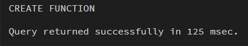

    ### ПРОВЕРКА
    SELECT get_max_price();

    
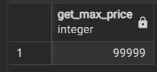

    3) Функция, которая возвращает ФИО клиетна по id.

    CREATE OR REPLACE FUNCTION get_client_full_name(select_client_id INT)
    RETURNS VARCHAR(50)
    LANGUAGE plpgsql
    AS $$
    BEGIN
        RETURN full_name FROM client WHERE client_id = select_client_id;
    END;
    $$;

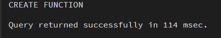

    ### ПРОВЕРКА
    SELECT get_client_full_name(16);

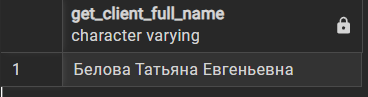

    4) Вывести все созданные функции.

    SELECT routine_name, routone_type
    FROM information_schema.routines
    WHERE routine_type = 'FUNCTION' AND schema_type = 'public';

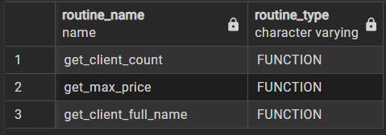

# 2.2. ФУНКЦИИ С ПЕРЕМЕННЫМИ

    1) Функция, которая вычисляет среднюю стоимость абонементов.

    CREATE OR REPLACE FUNCTION get_avg_price()
    RETURNS NUMERIC(10, 2)
    LANGUAGE plpgsql
    AS $$
    DECLARE
        required_avg NUMERIC(10, 2);
    BEGIN
        SELECT ROUND(AVG(price), 2) INTO required_avg
        FROM membership;

        RETURN required_avg;
    END;
    $$;

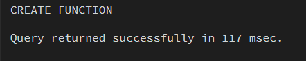

    ### ПРОВЕРКА
    SELECT get_avg_price();

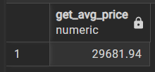

    2) Функция, которая выводит имя клиента и количество посещенных им тренировок (в формате: "Клиент [имя] посетил [кол-во] тренировок").

    CREATE OR REPLACE FUNCTION get_client_stats(select_client_id INT)
    RETURNS TEXT
    LANGUAGE plpgsql
    AS $$
    DECLARE 
        required_full_name VARCHAR(50);
        required_visit_count INT;
    BEGIN
        SELECT full_name INTO required_full_name
        FROM client
        WHERE client_id = select_client_id;

        SELECT COUNT(*) INTO required_visit_count
        FROM visit
        WHERE client_id = select_client_id;

        RETURN 'Клиент ' || required_full_name || ' посетил ' || required_visit_count || ' тренировок ';
    END;
    $$;

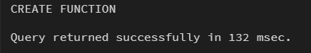

     ### ПРОВЕРКА
    SELECT get_client_stats(16);

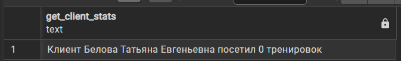

    3) Функция, которая принимает id клтента и выводит его цену на последний купленный абонемент со скидкой 20%.

    CREATE OR REPLACE FUNCTION get_discount_price(select_client_id INT)
    RETURNS NUMERIC(10, 2)
    LANGUAGE plpgsql
    AS $$
    DECLARE
        required_price INT;
    BEGIN
        SELECT price INTO required_price
        FROM membership
        WHERE client_id = select_client_id
        ORDER BY start_date DESC
        LIMIT 1;

        RETURN ROUND(required_price * 0.8);
    END;
    $$;

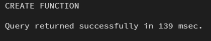

    ### ПРОВЕРКА
    SELECT get_discount_price(16);

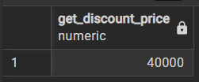

    SELECT price
    FROM membership
    WHERE client_id = 16
    ORDER BY start_date DESC
    LIMIT 1;

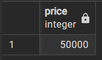

    4) Вывести все функции.

    SELECT routine_name, routine_type
    FROM information_schema.routines
    WHERE routine_type = 'FUNCTION' AND routine_schema = 'public';

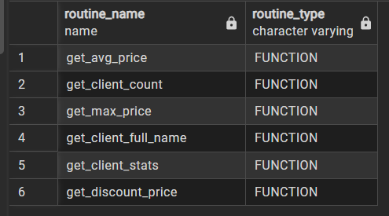

# 3. БЛОК DO

    1) Анонимный блок, который выводит ссобщение 'База данных FITNESS-CLUB готова к работе'.

    DO $$
    BEGIN
        RAISE NOTICE 'База данных FITNESS-CLUB готова к работе';
    END
    $$
    LANGUAGE plpgsql;

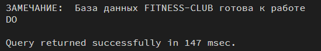

#  4. IF

    1) Функция, которая определяет уровень залы по вместимости: если вместимость больше 30 - верни 'Большой зал', иначе - 'Маленький зал'.

    CREATE OR REPLACE FUNCTION check_capacity(select_capacity INT)
    RETURNS TEXT
    LANGUAGE plpgsql
    AS $$
    DECLARE
        category TEXT;
    BEGIN
        IF select_capacity > 30 THEN
            category := 'Большой зал';
        ELSE
            category := 'Маленький зал';
        END IF;

        RETURN category;
    END
    $$;

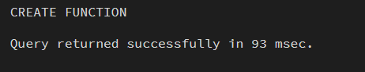

    ### ПРОВЕРКА
    SELECT  check_capacity((SELECT capacity FROM room WHERE room_id = (SELECT room_id FROM room LIMIT 1)));

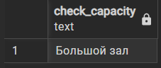

    SELECT capacity 
    FROM room 
    WHERE room_id = (SELECT room_id FROM room LIMIT 1);

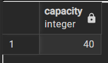

# 5. CASE

    1) Функция, которая определяет уровень тренера: 'Юниор' (если возраст < 25), 'Профи' (если 25-40), 'Ветеран' (если > 40).

    CREATE OR REPLACE FUNCTION get_coach_level(select_coach_age INT)
    RETURNS TEXT
    LANGUAGE plpgsql
    AS $$
        DECLARE
            category TEXT;
    BEGIN
        category := CASE 
            WHEN select_coach_age < 25 THEN 'Юниор'
            WHEN select_coach_age >= 25 AND select_coach_age <= 40 THEN 'Профи'
            ELSE 'Ветеран'
        END CASE;

        RETURN category;
    END
    $$;

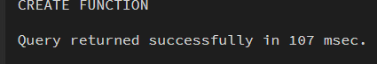

    ### ПРОВЕРКА
    SELECT get_coach_level((SELECT age FROM coach LIMIT 1));

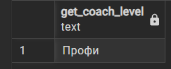

    SELECT age FROM coach LIMIT 1;

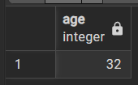

# 6. WHILE

    1) Процедура, которая создает в тренировках, select_count тренировок по йоге каждые 7 дней.

    CREATE OR REPLACE PROCEDURE generate_yoga_schedule(select_start_date TIMESTAMP, select_count INT, select_coach_id INT, select_duration INT, select_room_id INT)
    LANGUAGE plpgsql
    AS $$
    BEGIN
        select_start_date := select_start_date - INTERVAL '7 days';

        WHILE select_count > 1 LOOP
            INSERT INTO training (training_name, duration, datetime, room_id, coach_id) 
            VALUES ('Йога', select_duration, select_start_date + INTERVAL '7 days', select_room_id, select_coach_id);

            select_count := select_count - 1;
            select_start_date := select_start_date + INTERVAL '7 days';
        END LOOP;

        RAISE NOTICE 'Тренировки по йоге успешно записаны';
    END;
    $$;

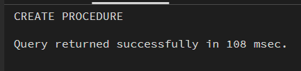

    ### ПРОВЕРКА
    CALL generate_yoga_schedule('2026-11-22 18:00'::TIMESTAMP, 5, 11, 85, 4);

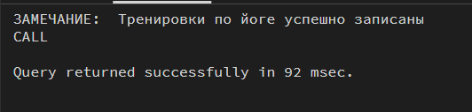

    SELECT t.training_id, t.duration, t.datetime, r.room_name, c.full_name
    FROM training t
    JOIN room r ON r.room_id = t.room_id
    JOIN coach c ON c.coach_id = t.coach_id
	WHERE t.datetime >= '2026-11-22 18:00'::TIMESTAMP  AND t.datetime <= ('2026-11-22 18:00'::TIMESTAMP + INTERVAL '28 days')
    ORDER BY datetime;

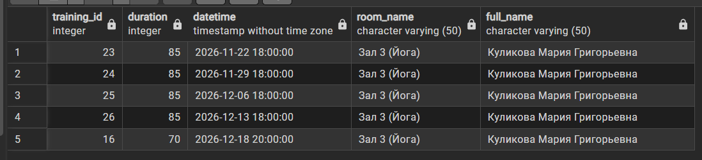

# 7. EXCEPTION

    1) Процедура, которая пытается удалить клиента. Если удаление не получилось, то ошибка должна перехватиться и выйти ошибка 'Ошибка удаления клиента'.

    CREATE OR REPLACE PROCEDURE safe_delete_client(select_client_id INT)
    LANGUAGE plpgsql
    AS $$
    BEGIN
        DELETE FROM client WHERE client_id = select_client_id;
        EXCEPTION
        WHEN others THEN
        RAISE NOTICE 'Ошибка удаления клиента';
    END;
    $$;

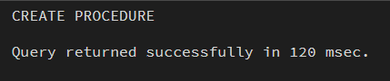

    ### ПРОВЕРКА
    CALL safe_delete_client(100);

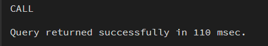

# 8. RAISE

    1) Процедура:  если передана цена меньшая или равная 0, вызывается исключение.

    CREATE OR REPLACE PROCEDURE validate_price(select_price INT)
    LANGUAGE plpgsql
    AS $$
    BEGIN
       IF select_price <= 0 OR select_price >= 100000 THEN
            RAISE EXCEPTION 'Цена не может быть отрицательной или нулевой!';
        END IF;
    END;
    $$;

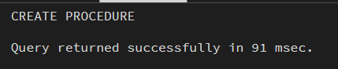

    ### ПРОВЕРКА
    CALL validate_price(900000);

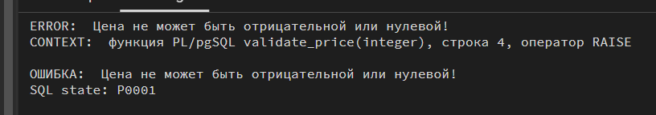